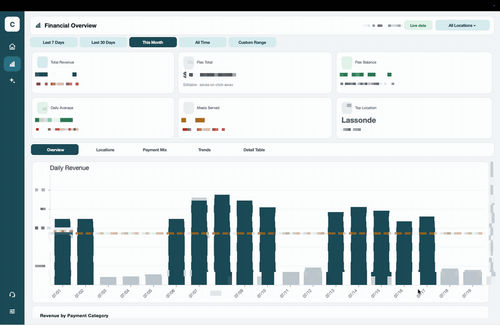
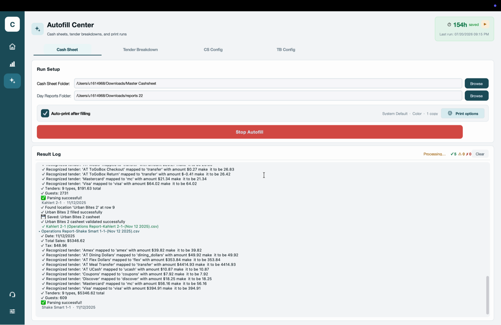
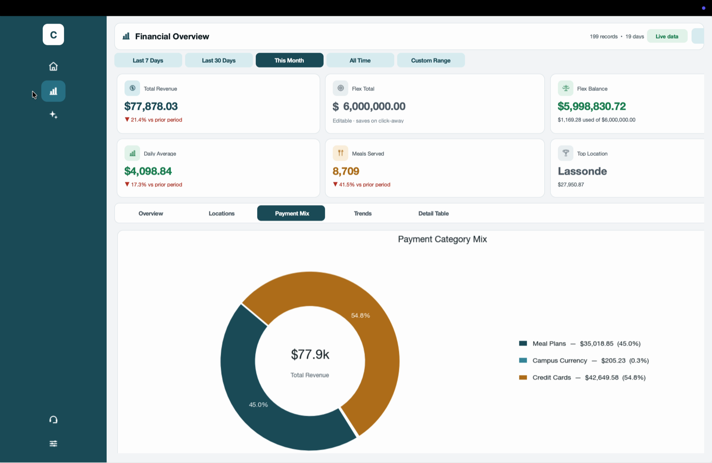
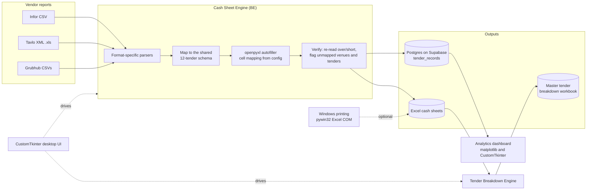
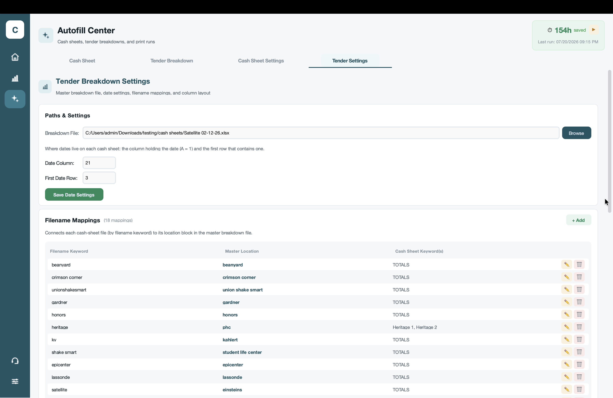

# Chartwells Automation

A Windows desktop app that turns a 1-hour daily reconciliation of about $77K in sales across 17 campus dining locations into one click. It reads three vendor report formats, converts them to one shared schema, fills in the accounting ledgers, checks the result and shows the numbers on an analytics dashboard.

Built for the Chartwells Higher Education dining team at the University of Utah. Staff with no technical background run it every day as a packaged `.exe` that needs no setup.

| | |
|---|---|
| Time saved | about 1 hour of manual data entry a day |
| Total | 300+ staff hours since Nov 2025 |
| Staffing | took over a data-entry role that was never refilled |



*The demo opens the analytics dashboard, runs the cash-sheet autofill with its live validation log, then opens the print options. Dollar figures are blurred.*

---

## The problem

Three point-of-sale and delivery systems each send a daily report in a different format:

| Source | Format | Shape |
| --- | --- | --- |
| Infor (campus POS) | Plain-text CSV split into sections | 1 file per venue per day |
| Tavlo (POS) | SpreadsheetML XML (`.xls`) | 1 file per venue per day |
| Grubhub (delivery) | Two CSVs, transactions and order counts | 1 file covering many venues, days and payment methods |

A staff member opened each report and read off sales, tax, guest counts and a dozen tender types. They typed each number into the right row, on the right weekday tab, of the right location's Excel cash sheet, for every venue every day. Then they did it again to roll the cash sheets into a master tender-breakdown workbook. It was slow, and one mistyped number broke reconciliation without anyone noticing.

## What the app does

1. It parses all three vendor formats and maps every payment type to one list of 12 tenders.
2. It fills each location's Excel cash sheet in the right cell, row and weekday tab. A JSON config drives the mapping, so adding a venue needs no code change.
3. It re-reads each sheet's over/short column after filling it and flags any mismatch between the report and the ledger.
4. It rolls the filled cash sheets into one master tender-breakdown workbook.
5. It saves every record to a Postgres database. The built-in dashboard reads from it to show revenue trends, payment mix, location rankings, meals served and flex balances.
6. It prints the finished sheets and the Infor and Tavlo reports to a chosen printer on Windows. Grubhub CSVs are filled in but never printed. The app also updates itself from GitHub Releases and tracks hours saved.

---

## Screenshots

| Autofill Center (live run) | Payment mix |
| --- | --- |
|  |  |

*On the left, the engine streams its result log: each tender it recognized, sales and guest counts per venue, and a validation line for each sheet. On the right, the analytics page reads the same records back from the database.*

---

## Architecture



The code has three layers:

- `UI/` is one CustomTkinter window with a sidebar and three pages: Home, Analytics and Auto-Fill Center. The UI holds no business logic. It starts the engines on worker threads and streams their events into a color-coded log.
- `BE/src/` holds the parsers, the Excel autofillers, verification, printing, the updater and the database manager. No engine imports Tkinter. Each one takes an `on_event` callback and a `stop_event`, so it can run with or without the GUI.
- A Postgres database on Supabase, reached through `psycopg2`, is the system of record. Filling the sheets and reporting on the numbers are separate jobs that meet only at the database.

---

## How the pipeline works

**1. Parse.** Each vendor has its own parser built on a small `BaseParser`. The Infor parser reads section markers. The Tavlo parser handles sparse SpreadsheetML rows that skip cells with `ss:Index`. The Grubhub parser handles data nested by venue and date, and it finds columns by header name each run, so it still works when Grubhub moves a column.

**2. Normalize.** A config table maps every raw tender name ("AT Meal Transfer", "Mastercard", "AT Flex Dollars" and so on) to one of 12 tenders: `contract_card, flex, transfer, coupons, ucash, ushop, chartwellsDCB, dining_dollars, amex, discover, mc, visa`. Location names go through Unicode normalization, so `"Café"` matches `"Cafe"`. Every parser returns the same shape: `location, date, total_sales, tax, count, net_sales, tenders{}`.

**3. Autofill.** `openpyxl` opens each location's workbook, picks the tab for the report's weekday and finds the location's row. It writes each value to the column the JSON config names. The config defines the whole mapping, with 22 location routes and 40 Grubhub venues mapped to 20 cash-sheet rows in [`cash_sheet_config.json`](BE/src/cash_sheet_filler/cash_sheet_config.json). Staff can edit all of it from the Cash Sheet Settings tab in the app.

**4. Verify.** After writing, the engine reopens the sheet and reads its over/short column. A non-zero value marks the fill as failed. `openpyxl` writes formulas but never calculates them, so when that column holds a formula, the engine reports the check as unverified instead of passed. Separately, the engine sums the tender columns against sales in Python, so a mismatch shows up before anyone opens the workbook. An unmapped tender leaking into the total is one example. Parsers also list any tender or venue they could not map as warnings. This check caught several early parser bugs and kept the numbers right as new venues were added.

**5. Roll up.** The Tender Breakdown engine reads the filled cash sheets back as values (`data_only=True`) and writes each location's daily figures into the right date row of one master workbook. It handles special cases such as adding up venues with more than one register.

**6. Save and report.** The engine upserts each record into `tender_records` with `ON CONFLICT (report_date, raw_location, location, source)`, so a second run on the same day updates rows instead of adding duplicates. The analytics page reads totals back for its KPIs and charts, with period-over-period comparison and a location filter.

**The arithmetic trace.** With `"verbose_trace": true` in [`cash_sheet_config.json`](BE/src/cash_sheet_filler/cash_sheet_config.json), which is the default, the log shows how it got every figure. It lists each CSV row's charged amount and the service fee taken off it, grouped by venue. It shows how several venues add up to one cash-sheet row, the discount added back to sales and to the `visa` tender, the tenders-against-sales balance, and the exact cell each number went into. Set it to `false` to log totals only.

```
┌ Absurd Bird · 07/28/2025  (3 row(s))
│ Credit Card      charged $   112.75  − fee $   3.25  = $   109.50  → visa             · tax $   8.42 · meals   9
│ Dining Dollars   charged $    55.30                  = $    55.30  → dining_dollars   · tax $   4.10 · meals   5 · discount $2.00 held
│ Meal Swipes      charged $    18.00                  = $    18.00  → transfer         · tax $   1.20 · meals   2 · merged from "- Meal Transfer"
└ venue total: sales $182.80 · tax $13.72 · discounts held $2.00 · meals 16
┌ row 'grubhub' (Gardner Food Court) · 07/28/2025 ← Absurd Bird + Cupbop + Iron Waffle
│ order count : 15 + 6 + 3 = 24
│ sales       : $182.80 + $77.90 + $33.00 = $293.70
│ discounts   : $2.00 added back → visa $187.40 → $189.40, sales $293.70 → $295.70
│ balance     : tenders $295.70 vs sales $295.70  ✓ balances
│ wrote       : U1 date 07/28/2025 · A13 count 24 · C13 sales 295.70 · C14 tax 22.22 · S13 visa 189.40 …
```

---

## Adding venues and tenders without code

The Cash Sheet Settings and Tender Settings tabs in the Auto-Fill Center show the whole configuration as tables you can add to, edit and delete from.



- Cash Sheet Locations sets where a new Infor or Tavlo location goes: its workbook, its register row and its name on the Analytics page.
- Grubhub Venues does the same for venues on the Grubhub report.
- Fill Columns and Checking Columns set which spreadsheet column each value goes into and which columns the verify step reads.
- Tender maps teach the app a new tender name from any vendor and map it to one of the 12 tenders.
- Tender Settings covers the master workbook: filename to location mappings, each location's start column and the date and data column layout.

Each dialog explains its fields with examples, checks numeric input and blocks duplicate names. Every change goes straight to the JSON config the engines read. Staff can add a new dining venue in under a minute from the packaged `.exe` without opening a file.

---

## Tech stack

- Python 3.11
- CustomTkinter for the desktop UI
- Matplotlib for charts, embedded with `FigureCanvasTkAgg` and drawn off the main thread
- openpyxl to read and write Excel, including the formula-aware check
- PostgreSQL on Supabase through psycopg2, with parameterized queries and validated column names
- pywin32 for Excel COM printing and printer settings on Windows
- PyInstaller and GitHub Actions to build the Windows app and publish it as a GitHub Release
- An in-app updater that checks GitHub Releases, downloads the new build and replaces itself

---

## Project structure

```
BE/src/
├── cash_sheet_filler/        # Vendor parsers and the Excel autofill engine
│   ├── base_parser.py            # shared logging base class
│   ├── infor_parser.py           # Infor CSV with sections
│   ├── tavlo_parser.py           # Tavlo SpreadsheetML XML
│   ├── grubhub_parser.py         # Grubhub transactions (sales, tax, tenders)
│   ├── grubhub_order_count_parser.py  # Grubhub order counts (the source for counts)
│   ├── excel_autofiller.py       # openpyxl cell targeting and over/short check
│   ├── main.py                   # CashSheetAutofillEngine (runs the steps)
│   └── cash_sheet_config.json    # location routes, tender maps, cell columns
├── tender_break/             # Cash sheets to the master tender-breakdown workbook
├── db/tendersdb_manager.py   # Postgres manager (upsert and analytics totals)
├── printer.py                # Windows Excel COM printing
├── updater.py                # GitHub Releases auto-updater (CURRENT_VERSION)
├── time_tracker.py           # hours-saved counter (time_saved.json)
└── path_helper.py            # path lookup for the frozen .exe and for development

UI/
├── dashboard.py              # app window, sidebar and pages
└── components/
    ├── sidebar.py            # sidebar that expands on hover
    ├── autofill_center.py    # Auto-Fill Center (cash sheet, tender, config tabs)
    ├── autofill_center_runtime.py  # threads, stop events, live log
    ├── analyticsPage.py      # dashboard with KPIs and 5 chart tabs
    ├── taskManager.py        # team task board
    └── theme.py              # one shared color theme
```

---

## Getting started (development)

```bash
# 1. Create and activate a virtual environment
python -m venv .venv
source .venv/bin/activate        # Windows: .venv\Scripts\Activate.ps1

# 2. Install dependencies
pip install -r requirements.txt

# 3. Point the app at Postgres (analytics and the record log)
echo "DATABASE_URL=postgresql://..." > .env

# 4. Run
python UI/dashboard.py
```

Parsing and autofill run on any OS. Printing and self-update use pywin32 and replace the `.exe`, so they only work on Windows and do nothing elsewhere.

### Build the Windows executable

```bash
pyinstaller chartwells.spec --clean
# Output: dist/ChartwellsAutomation/ChartwellsAutomation.exe
```

CI ([`.github/workflows/build.yml`](.github/workflows/build.yml)) builds the same app on `windows-latest` and publishes it as a GitHub Release when a `v*.*.*` tag is pushed. The in-app updater then picks it up. `CURRENT_VERSION` lives in [`updater.py`](BE/src/updater.py).

In the packaged app, the config and the hours-saved file live in an editable `config/` folder next to the `.exe`, so staff can change mappings without touching code. The first run copies the bundled defaults into that folder. After that, each launch only adds what the shipped defaults have gained, such as a new location, tender or setting. It never replaces or removes a value, including staff-added locations and folder paths.

The database connection lives in a `.env` file next to the `.exe` on each staff machine, set up once by hand. Release assets are public, so the build never ships a `.env`, and CI fails if one appears in the tree or the output. The updater copies new files over the app folder and never deletes, so that `.env` survives every update.

---

## Demo walkthrough

1. The app opens on the Analytics page. It shows the Financial Overview with KPI cards (Total Revenue, Flex Total and Balance, Daily Average, Meals Served, Top Location) and a daily revenue bar chart, all read from the database.
2. Open Auto-Fill Center from the sidebar and go to the Cash Sheet tab. The Cash Sheet Folder and Day Reports Folder are already filled in, and the header shows the hours-saved count.
3. Click Run Cash Sheet Autofill. The button turns into a red Stop Autofill button and the status changes from Ready to Processing. The result log streams each tender, venue totals, guest counts and a "validated successfully" line for each sheet, and the success, warning and error counters go up.
4. Click Stop Autofill. The run stops at the next safe point and the status reads Cancelled. You can also open Print options to change the printer or switch to black and white. That changes the next run's settings and does not stop the current run.
5. Go back to Analytics. The page queries the database again when it opens (`on_show()`), so the charts refresh. The chart tabs are Overview (daily revenue), Locations (ranked), Payment Mix (donut), Trends (this period against the last) and Detail Table. You can switch date presets or filter by location.

---

## Design decisions

- **Config instead of code.** Adding a dining venue is a JSON edit or a few clicks in the settings tabs. Routes, tender names and target cells are all data, which is why accuracy held as locations were added.
- **Verification as its own step.** The engine treats "the sheet saved" and "the sheet balances" as two different results. The accounting team found catching hidden mismatches more useful than anything else in the app.
- **Engines separate from the UI.** Each engine is a plain class with an `on_event` callback and a `stop_event`, with no Tkinter imports. Runs can be cancelled, tested and scripted without the GUI.
- **The database between filling and reporting.** The two jobs share nothing but Postgres, so the analytics dashboard only reads an upserted record log that a rerun can't duplicate.
